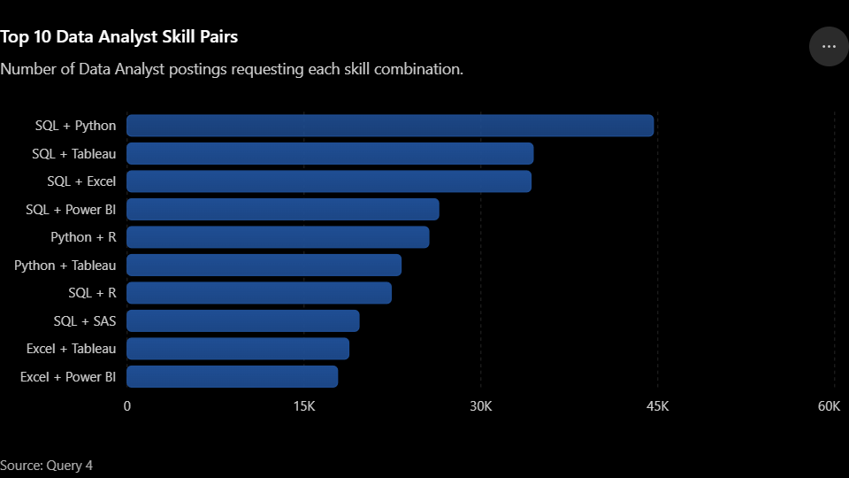
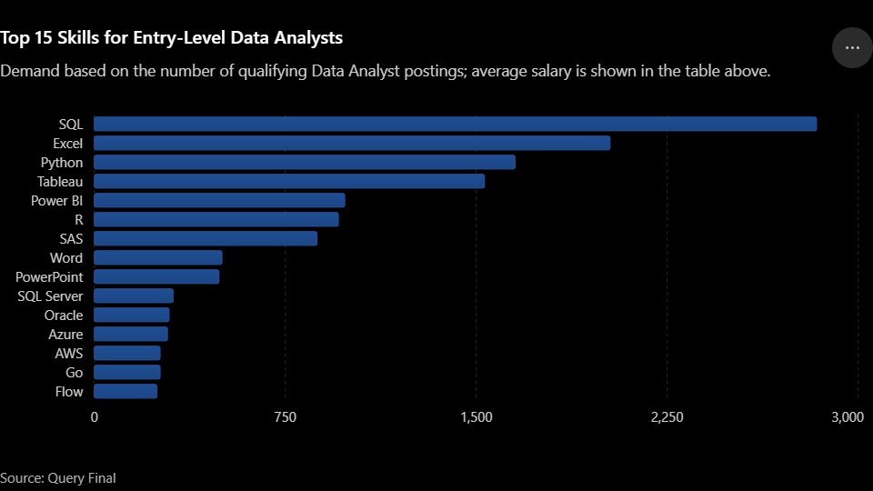

# Breaking Into Data Analytics: What the Job Market Actually Rewards

A SQL-based analysis of real-world Data Analyst job postings, built to answer the
questions I actually had as a self-taught, no-degree career changer: what does
this market really pay, reward, and require — and where should I focus first?

## Dataset

Built on the open [`data_jobs`](https://github.com/lukebarousse/data_jobs) dataset
(job postings scraped from Google Jobs), loaded into a local PostgreSQL database.

| Table | Contents |
|---|---|
| `job_postings_fact` | One row per posting — title, salary, location, remote flag, benefits flags, posted date |
| `company_dim` | Company names |
| `skills_dim` | Skill reference table |
| `skills_job_dim` | Bridge table linking postings to required skills |

## Tools

PostgreSQL · SQL (CTEs, subqueries, self-joins, aggregate functions, temp tables)

## Questions

| # | Question | File |
|---|---|---|
| 1 | What's the realistic entry point for postings that don't require a degree? | `query-1.sql` |
| 2 | Does mentioning health insurance correlate with pay? | `query-2.sql` |
| 3 | Which companies post the most Data Analyst jobs, and do they pay well? | `query-3.sql` |
| 4 | Which two skills most often appear together in the same posting? | `query-4.sql` |
| 5 | Which skills give beginners the best return — high demand, without being gated behind senior-sounding titles? | `query-final.sql` |

---

## Findings

### 1. The "no degree required" entry point pays close to market rate

- Avg salary: **$92,951** (range $26,444–$650,000, n=1,236 postings with salary listed)
- Titles are overwhelmingly generic "Data Analyst," but "Lead Data Analyst" and
  "Data Architect" also appear — no-degree isn't confined to junior roles
- Top skills: **SQL → Excel → Python → Tableau → Power BI**

~$93K is roughly on par with market-wide Data Analyst pay, which pushes back on
the assumption that skipping a degree caps earning potential. The $650K max is
likely an outlier and shouldn't be read as typical.

### 2. Health insurance correlates with slightly *higher* pay, not lower

| | Mentions health insurance | Doesn't |
|---|---|---|
| Postings | 2,322 | 3,141 |
| Avg salary | $95,550 | $92,638 |

A ~3% premium (~$2,912) — real, but modest. No evidence of a benefits-for-salary
tradeoff in this data. Worth noting the $650K outlier sits in the *no-insurance*
group, so it shouldn't be misread as skewing the "with insurance" number.

### 3. Biggest employers aren't always the best-paying — and many aren't direct employers at all

| Company | Postings | Avg Salary |
|---|---|---|
| Emprego | 1,121 | — |
| Robert Half | 1,047 | $89,111 |
| Insight Global | 892 | $92,801 |
| **Citi** | 875 | **$121,509** |
| Dice | 604 | $107,500 |
| UnitedHealth Group | 592 | $103,464 |
| Confidenziale | 549 | — |
| Get It Recruit | 510 | $87,489 |
| Michael Page | 468 | $97,000 |
| Randstad | 462 | $92,500 |

Six of the top 10 are staffing/recruiting agencies, not companies hiring for
their own teams. **Citi** is the standout: the only employer in the top 10
combining high volume with the highest average pay. Two of the top posters
(including the #1 by volume) disclosed no salary data at all.

### 4. SQL is the hub skill

| Pair | Count |
|---|---|
| SQL + Python | 44,630 |
| SQL + Tableau | 34,434 |
| SQL + Excel | 34,254 |
| SQL + Power BI | 26,424 |
| Python + R | 25,588 |
| Python + Tableau | 23,233 |
| SQL + R | 22,395 |
| SQL + SAS | 19,666 |
| Excel + Tableau | 18,803 |
| Excel + Power BI | 17,847 |

SQL appears in 7 of the top 10 skill pairs, and SQL + Python is the single
strongest pairing by a wide margin — nearly 10,000 postings ahead of the next
closest pair — making it a natural second skill to learn after SQL itself. The
chart also makes visible a "SQL + a visualization tool" cluster (Tableau,
Power BI, Excel), suggesting querying and presenting are expected together
rather than one specific tool being mandatory.

### 5. Two independent "beginner" filters converge on the same core skills

Filtering separately by (a) "no degree mentioned" and (b) "non-senior job title"
both surface the same top 5, in nearly the same order: **SQL, Excel, Python,
Tableau, Power BI.** That agreement across two unrelated filters is a stronger
signal than either list alone.

| Skill | Demand | Avg salary |
|---|---|---|
| SQL | 2,836 | $93,918 |
| Excel | 2,025 | $84,441 |
| Python | 1,652 | $98,495 |
| Tableau | 1,532 | $95,494 |
| Power BI | 983 | $90,825 |
| R | 958 | $95,294 |
| SAS | 874 | $90,476 |
| Word | 501 | $81,379 |
| PowerPoint | 489 | $86,023 |
| SQL Server | 309 | $93,730 |
| Oracle | 293 | $97,363 |
| Azure | 287 | $103,104 |
| AWS | 258 | $103,769 |
| Go | 258 | $92,288 |
| Flow | 245 | $96,086 |

Excel has the lowest average salary of the top 5 despite being #2 in demand —
likely a baseline expectation rather than a differentiator. Python and Tableau
pay somewhat more than SQL despite lower demand, suggesting a "SQL first, then
specialize" path. Word and PowerPoint cracking the top 10 (the 8th and 9th
bars in the chart) is a reminder the role isn't purely technical even at entry
level. Notably, Azure and AWS — despite sitting near the bottom of the demand
ranking — carry the two highest average salaries on the entire list, hinting
at a demand-vs-pay tradeoff for cloud/platform skills that could be worth its
own follow-up question.

---

## Conclusion & Insights

Across all five questions, one thread keeps surfacing: **this market rewards
demonstrated skill more than it rewards credentials or a company's hiring
volume.** No-degree-required postings pay close to the broader Data Analyst
average (Finding 1), and two completely independent ways of defining
"beginner-friendly" — filtering by degree mention versus filtering by job
title seniority — land on the exact same core skill set (Finding 5). That
convergence across unrelated filters is the strongest single piece of
evidence in this project: it's not an artifact of one filtering choice, it's
a real pattern in how the market talks about entry-level roles.

**Cross-cutting insights:**

- **SQL is the load-bearing skill of this entire analysis.** It tops the
  demand list under every filter tested (no-degree, entry-level, and
  unfiltered), and it anchors 7 of the top 10 skill pairings (Finding 4). If
  one skill has to come first, the data says it's this one.
- **Volume isn't a proxy for opportunity.** The companies posting the most
  jobs are frequently staffing agencies, not direct employers, and two of the
  top 10 posters didn't even disclose salary (Finding 3). Citi was the one
  exception that combined high volume with high pay — "who's hiring the
  most" and "who pays the best" turn out to be different questions.
- **Benefits don't come at the cost of salary.** Postings mentioning health
  insurance paid slightly more, not less (Finding 2) — there's no evidence in
  this dataset of employers trading cash comp for benefits.
- **Demand and pay aren't the same axis.** Excel is the second most-demanded
  skill but the lowest-paid of the top 5 (Finding 5), while Azure and AWS sit
  near the bottom of demand but the top of average pay — suggesting that once
  the core stack (SQL, Excel, Python, a viz tool) is in place, a cloud skill
  may be where the next salary gain comes from, even if it's not the most
  urgent thing to learn first.

**A practical starting path, based on this data:** SQL first — it's the
highest-demand skill under every filter and the hub of the pairing graph.
Pair it next with Python (the single strongest pairing) and one visualization
tool — Tableau, Power BI, and Excel all show up interchangeably, so which one
matters less than having one. Don't let the absence of a degree be a reason
to hold off applying — the data doesn't support a pay penalty for it. And once
the fundamentals are solid, a cloud platform skill (Azure or AWS) looks like a
reasonable next differentiator, given its outsized pay relative to its
current demand.

---

## Methodology notes

- **Temp tables** were used where the same filtered subset (e.g. "no degree
  required" postings) fed three separate, independent queries — avoids
  repeating the filter logic across each one.
- **CTEs** were used where multiple aggregated results needed to be joined into
  one final combined output within a single statement (e.g. `query-final.sql`,
  which builds an entry-level job set, then aggregates skill demand/salary
  against it).
- **Skill pairing** (`query-4.sql`) used a self-join on `skills_job_dim` with a
  `skill_id_a < skill_id_b` condition so each unique pair is counted once,
  rather than twice or paired with itself.
- All queries scoped to `job_title_short = 'Data Analyst'` for consistency
  across the whole project.

## Files

- `query-1.sql` — entry point (no degree required)
- `query-2.sql` — benefits vs. pay
- `query-3.sql` — top employers
- `query-4.sql` — skill pairing
- `query-final.sql` — optimal skills for beginners
- `images/top_10_skill_pairs.png` — chart for Finding 4
- `images/top_15_entry_level_skills.png` — chart for Finding 5

## What I'd explore next

- Remote vs. on-site salary comparison
- Month-over-month hiring trend across 2023
- The $650K salary outlier from Question 1 — legitimate senior role, or data error?

## What I Learned

**On the SQL side:**
- Core querying — `SELECT`, `WHERE`, `ORDER BY`, `DISTINCT`, aliasing — up
  through aggregate functions, `GROUP BY`, and `HAVING`
- Why NULL comparisons return *unknown* rather than false, and how that quietly
  changes what a filter actually includes
- `INNER JOIN` vs. `LEFT JOIN` as a real decision, not interchangeable syntax —
  `LEFT JOIN` when the zero case still needs to show up (companies with no
  postings), `INNER JOIN` when a match is always guaranteed (skill IDs that
  already reference real skills)
- CTEs vs. subqueries vs. temp tables as three different tools for three
  different situations, not three ways to write the same thing — CTEs for
  combining pieces within one statement, temp tables for reusing a filtered
  set across several separate statements
- A self-join with a `skill_id_a < skill_id_b` condition to count each unique
  skill pair exactly once instead of twice
- Date functions like `EXTRACT()`, and how time zone conversion can shift
  which day or month a timestamp actually falls into
- `CASE` statements to turn raw numbers into labeled categories

**On the "getting the data in the first place" side:**
Honestly, a good chunk of the real learning here wasn't in the SQL itself — it
was getting a working PostgreSQL environment up from nothing: installing
PostgreSQL, fixing a broken service, connecting pgAdmin and SQLTools, and then
methodically working through a CSV import that broke in almost every way it
could — mismatched schemas, wrong file paths, swapped files, column-width
limits, UTF-8 encoding errors, and Windows file-permission issues. None of
that shows up in a finished query, but debugging it end-to-end start to finish
was arguably the most "real job" part of this whole project.

---

If the data here is right that this market rewards demonstrated skill over
credentials, then this project is the proof — not just an analysis of that
claim, but a working example of it.
