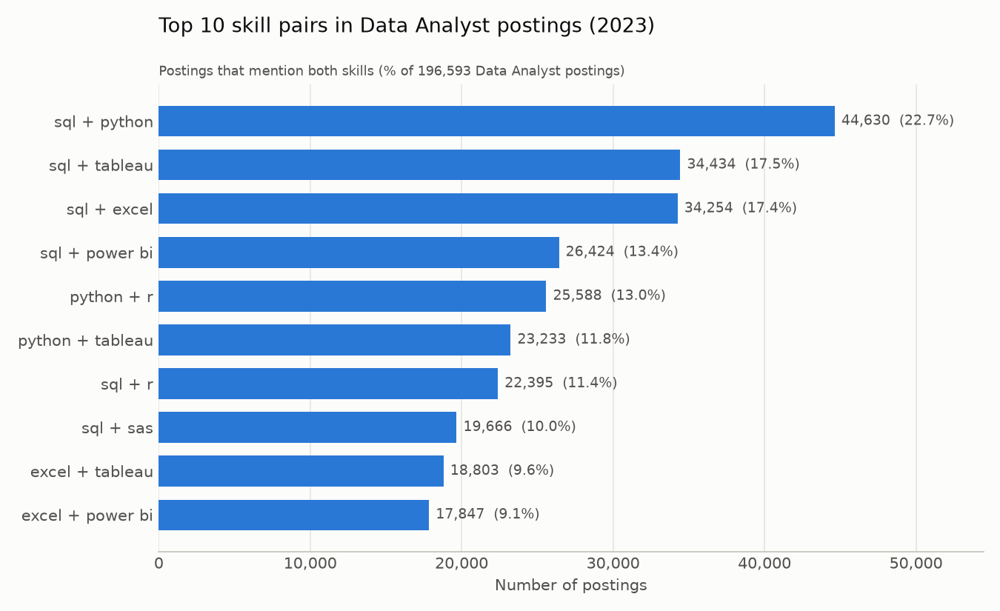
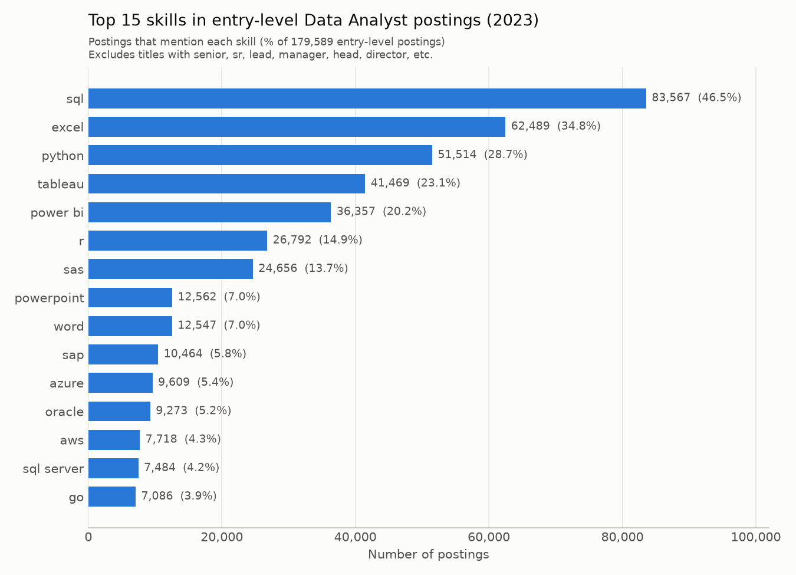

# Breaking Into Data Analytics: What 2023 Job Postings Ask For

I'm Dang Phat Tai, a first-year Business Administration (High-Quality Program)
student at Can Tho University, Vietnam, teaching myself data analytics. This is a
SQL analysis of real Data Analyst job postings, built to answer the questions I
had as a beginner: what do these postings pay, which skills do they ask for, and
where should I start?

## Dataset

Built on the open [`data_jobs`](https://github.com/lukebarousse/data_jobs) dataset
(job postings scraped from Google Jobs), loaded into a local PostgreSQL database.
The analysis covers the 196,593 postings with `job_title_short = 'Data Analyst'`.

| Table | Contents |
|---|---|
| `job_postings_fact` | One row per posting — title, salary, location, remote flag, benefits flags, posted date |
| `company_dim` | Company names |
| `skills_dim` | Skill reference table |
| `skills_job_dim` | Bridge table linking postings to required skills |

## Tools

PostgreSQL · SQL (CTEs, subqueries, self-joins, aggregate functions, `PERCENTILE_CONT`, regex filters, temp tables) · Python/matplotlib for the charts (`project-sql/make_charts.py`)

## Questions

| # | Question | File |
|---|---|---|
| 1 | What do postings that don't mention a degree look like, and do they pay less? | `project-sql/query-1.sql` |
| 2 | Does mentioning health insurance correlate with pay? | `project-sql/query-2.sql` |
| 3 | Which companies post the most Data Analyst jobs, and what do they pay? | `project-sql/query-3.sql` |
| 4 | Which two skills most often appear together in the same posting? | `project-sql/query-4.sql` |
| 5 | Which skills do entry-level postings ask for most, and how does pay differ? | `project-sql/query-final.sql` |

**How to read the salary numbers:** the main figure is the **median**
(`PERCENTILE_CONT(0.5)`). Averages are shown next to it, but they are pulled up by
a few very high values (the max is $650,000). Only 5,463 of the 196,593 postings
(2.8%) list a yearly salary, so every salary figure shows **n** = the number of
postings it is based on.

---

## Findings

### 1. Postings that don't mention a degree have the same median salary

76,057 Data Analyst postings (38.7%) don't mention a degree.

| | No degree mentioned | All other postings |
|---|---|---|
| Postings | 76,057 | 120,536 |
| Postings with salary (n) | 1,236 | 4,227 |
| **Median salary** | **$90,000** | **$90,000** |
| Average salary | $92,951 | $94,146 |

- The medians are the same. The average is $1,195 lower for no-degree postings.
- Salary range for no-degree postings: $26,444 to $650,000. The $650K value is likely an outlier.
- Most titles are generic "Data Analyst" (18,603), but "Lead Data Analyst" (397)
  and "Data Architect" (389) are also in the top 10, so these postings are not only junior roles.
- Top skills (% of no-degree postings): **SQL 42.0%, Excel 27.0%, Python 22.8%, Tableau 18.5%, Power BI 17.7%**

Only 1.6% of the no-degree postings list a salary. Also, a posting not mentioning
a degree tells us what the posting says, not who actually gets hired.

### 2. Mentioning health insurance shows no clear pay difference

`job_health_insurance` means the posting *mentions* health insurance. `FALSE` does
not mean the job has no health insurance.

| | Mentions health insurance | Doesn't mention it |
|---|---|---|
| Postings with salary (n) | 2,322 | 3,141 |
| **Median salary** | **$90,000** | **$90,000** |
| Average salary | $95,550 | $92,638 |

The averages differ by $2,912 (about 3%), but the medians are the same. The $650K
max is in the "doesn't mention" group.

### 3. Most of the biggest posters are not direct employers, and most don't list salaries

| Company | Type | Postings | With salary (n) | Median | Average |
|---|---|---|---|---|---|
| Emprego | Job board | 1,121 | 0 | — | — |
| Robert Half | Staffing agency | 1,047 | 108 | $87,500 | $89,111 |
| Insight Global | Staffing agency | 892 | 96 | $92,500 | $92,801 |
| **Citi** | Direct employer | 875 | 90 | **$125,540** | $121,509 |
| Dice | Job board | 604 | 1 | * | * |
| UnitedHealth Group | Direct employer | 592 | 7 | * | * |
| Confidenziale | Anonymous employer | 549 | 0 | — | — |
| Get It Recruit - IT | Staffing agency | 510 | 139 | $84,000 | $87,489 |
| Michael Page | Staffing agency | 468 | 5 | * | * |
| Randstad | Staffing agency | 462 | 3 | * | * |

\* Fewer than 30 postings with salary, too few to compare.

- 8 of the top 10 are not direct employers: 5 staffing agencies, 2 job boards, and
  1 anonymous employer ("Confidenziale" is Italian for "confidential").
- Only 4 of the top 10 have at least 30 postings with salary. Among those 4, Citi
  has the highest median: $125,540 (n=90). The other three are between $84,000 and $92,500.

### 4. SQL is the hub skill

| Pair | Postings | % of Data Analyst postings |
|---|---|---|
| SQL + Python | 44,630 | 22.7% |
| SQL + Tableau | 34,434 | 17.5% |
| SQL + Excel | 34,254 | 17.4% |
| SQL + Power BI | 26,424 | 13.4% |
| Python + R | 25,588 | 13.0% |
| Python + Tableau | 23,233 | 11.8% |
| SQL + R | 22,395 | 11.4% |
| SQL + SAS | 19,666 | 10.0% |
| Excel + Tableau | 18,803 | 9.6% |
| Excel + Power BI | 17,847 | 9.1% |

- SQL appears in 6 of the top 10 pairs.
- SQL + Python is #1 by 10,196 postings (5.2 percentage points) over #2, SQL + Tableau.
  #2 and #3 (SQL + Excel) are only 180 postings apart.
- SQL is often listed with a reporting tool: Tableau (17.5%), Excel (17.4%) and Power BI (13.4%).

### 5. The beginner filters show the same core skills as the whole market

"Entry-level" here means Data Analyst postings whose title does not contain the
whole words senior, sr, lead, leader, teamlead, principal, staff, manager, head or
director. This keeps 179,589 postings (91.4%).

| Skill | Demand (postings) | % of entry-level postings | With salary (n) | **Median** | Average |
|---|---|---|---|---|---|
| SQL | 83,567 | 46.5% | 2,659 | **$90,000** | $92,356 |
| Excel | 62,489 | 34.8% | 1,920 | **$80,850** | $82,726 |
| Python | 51,514 | 28.7% | 1,556 | **$95,000** | $96,964 |
| Tableau | 41,469 | 23.1% | 1,421 | **$90,000** | $93,389 |
| Power BI | 36,357 | 20.2% | 913 | **$87,500** | $88,598 |
| R | 26,792 | 14.9% | 894 | **$90,000** | $93,016 |
| SAS | 24,656 | 13.7% | 812 | **$90,000** | $88,586 |
| PowerPoint | 12,562 | 7.0% | 455 | **$81,682** | $83,948 |
| Word | 12,547 | 7.0% | 467 | **$76,650** | $79,586 |
| SAP | 10,464 | 5.8% | 156 | **$89,550** | $89,553 |
| Azure | 9,609 | 5.4% | 261 | **$98,038** | $101,272 |
| Oracle | 9,273 | 5.2% | 264 | **$91,050** | $95,969 |
| AWS | 7,718 | 4.3% | 236 | **$100,000** | $100,412 |
| SQL Server | 7,484 | 4.2% | 292 | **$90,000** | $92,501 |
| Go | 7,086 | 3.9% | 248 | **$88,625** | $91,554 |

**Baseline check:** with no filter at all (all 196,593 Data Analyst postings), the
top 15 skills are the same, in the same order (SQL 47.1%, Excel 34.1%, Python
29.2%, Tableau 23.7%, Power BI 20.1%). The no-degree list in Finding 1 has the same
top 5. So SQL, Excel, Python, Tableau and Power BI are simply the core Data Analyst
skills, not something special to beginner postings. The entry-level filter keeps
91.4% of postings, so it changes little.

- Excel is #2 in demand but has the lowest median of the top 5: $80,850 (n=1,920).
- Python has the highest median of the top 5: $95,000 (n=1,556). SQL and Tableau are both $90,000.
- Postings that mention AWS ($100,000, n=236) or Azure ($98,038, n=261) have the
  two highest medians in this list, but they appear in only 4.3% and 5.4% of entry-level postings.
- Word and PowerPoint each appear in 7.0% of entry-level postings.

---

## Conclusion & Insights

The clearest pattern is that the same small set of skills tops every list,
whichever way the postings are filtered.

- **SQL comes first everywhere.** It is the most requested skill in no-degree
  postings (42.0%), entry-level postings (46.5%) and all Data Analyst postings
  (47.1%), and it appears in 6 of the top 10 skill pairs.
- **The core skills are the same for beginners and for everyone.** The unfiltered
  top 15 matches the entry-level top 15 exactly, so the list describes the Data
  Analyst role in general, not a special beginner path.
- **Who posts the most is not who shows pay.** 8 of the top 10 posters are agencies,
  job boards or anonymous, and 6 of the 10 have fewer than 30 postings with salary.
  Citi is the one large poster with both enough salary data and a high median ($125,540, n=90).
- **Demand and pay are different things.** Excel is in 34.8% of entry-level postings
  but has a median of $80,850. AWS (4.3%) and Azure (5.4%) have medians
  near $100,000. This does not show that learning a cloud skill raises pay; those
  postings may also differ in seniority, location or industry.
- **Salary comparisons between groups show small or no gaps.** No-degree vs other
  postings and health-insurance vs not both have the same median ($90,000).

**A practical starting path, based on this data:** SQL first. Then Python (the most
common partner of SQL, 22.7% of postings) and one reporting tool (Tableau, Excel or
Power BI). Whether a cloud skill (AWS or Azure) helps later is a hypothesis for
another analysis, not a result of this one.

---

## Methodology notes

- **Medians** (`PERCENTILE_CONT(0.5) WITHIN GROUP (ORDER BY salary_year_avg)`) are
  the main salary figure, with `COUNT(salary_year_avg)` shown as the sample size.
  Salaries are only compared for groups with at least 30 postings with salary.
- **Demand vs salary:** in `query-final.sql`, demand counts *all* entry-level
  postings for a skill, while salary stats use only the postings that list a salary.
  (An earlier version counted demand only among postings with a salary, which made
  SQL's demand 2,836 instead of 83,567.)
- **Entry-level filter:** a whole-word regex
  (`job_title !~* '\m(senior|sr|lead|...|director)\M'`). Plain `ILIKE '%head%'`-style
  matching removed wrong titles such as "CSR Data Analyst", "Staffordshire" and
  "Headquartered". `query-final.sql` also shows how many postings each word removes.
- **Temp tables** were used where the same filtered subset (e.g. "no degree
  required" postings) fed several separate queries — avoids repeating the filter
  logic across each one.
- **CTEs** were used where multiple aggregated results needed to be joined into
  one final combined output within a single statement (e.g. `query-final.sql`,
  which builds an entry-level job set, then aggregates skill demand/salary
  against it).
- **Skill pairing** (`query-4.sql`) used a self-join on `skills_job_dim` with a
  `skill_id_a < skill_id_b` condition so each unique pair is counted once,
  rather than twice or paired with itself.
- All queries scoped to `job_title_short = 'Data Analyst'` for consistency
  across the whole project.

## Limitations

- **Time and source:** postings from Google Jobs, dated 2022-12-31 to 2023-12-31.
  The market may have changed since.
- **Few salaries:** only 5,463 of 196,593 Data Analyst postings (2.8%) list a yearly salary.
  Salary results describe that minority, not all postings.
- **USD and mostly US:** salaries are in USD, and 79.8% of the postings with a salary
  are in the United States.
- **Noisy skill tags:** skills are extracted from posting text, so some tags are
  unreliable (e.g. "go" and "flow" can come from ordinary words).
- **Title-based seniority:** the entry-level filter only looks at job titles.
  A title without "senior" can still be a senior role.
- **Not the Vietnamese market:** only 338 of the postings are in Vietnam. These
  results do not describe the job market in Vietnam.
- **Postings, not hiring:** the data shows what postings say, not who gets hired or what they are paid.

## Files

- `project-sql/query-1.sql` — postings with no degree mentioned
- `project-sql/query-2.sql` — health insurance vs. pay
- `project-sql/query-3.sql` — top employers
- `project-sql/query-4.sql` — skill pairing
- `project-sql/query-final.sql` — entry-level skills, filter check and baseline
- `project-sql/make_charts.py` — regenerates both charts from query-4 and query-final (needs the local `sql_course` database; run `python project-sql/make_charts.py`)
- `images/top_10_skill_pairs.png` — chart for Finding 4
- `images/top_15_entry_level_skills.png` — chart for Finding 5

## What I'd explore next

- Remote vs. on-site salary comparison
- Month-over-month hiring trend across 2023
- The $650K salary outlier from Question 1 — legitimate senior role, or data error?
- Whether the AWS/Azure salary gap holds after controlling for country and seniority
- The same questions on Vietnamese job postings

## What I Learned

**On the SQL side:**
- Core querying — `SELECT`, `WHERE`, `ORDER BY`, `DISTINCT`, aliasing — up
  through aggregate functions, `GROUP BY`, and `HAVING`
- Why NULL comparisons return *unknown* rather than false, and how that quietly
  changes what a filter actually includes
- `INNER JOIN` vs. `LEFT JOIN` as a real decision, not interchangeable syntax —
  `LEFT JOIN` when the zero case still needs to show up (companies with no
  postings), `INNER JOIN` when a match is always guaranteed (skill IDs that
  already reference real skills)
- CTEs vs. subqueries vs. temp tables as three different tools for three
  different situations, not three ways to write the same thing — CTEs for
  combining pieces within one statement, temp tables for reusing a filtered
  set across several separate statements
- A self-join with a `skill_id_a < skill_id_b` condition to count each unique
  skill pair exactly once instead of twice
- Date functions like `EXTRACT()`, and how time zone conversion can shift
  which day or month a timestamp actually falls into
- `CASE` statements to turn raw numbers into labeled categories

**On the "getting the data in the first place" side:**
Honestly, a good chunk of the real learning here wasn't in the SQL itself — it
was getting a working PostgreSQL environment up from nothing: installing
PostgreSQL, fixing a broken service, connecting pgAdmin and SQLTools, and then
methodically working through a CSV import that broke in almost every way it
could — mismatched schemas, wrong file paths, swapped files, column-width
limits, UTF-8 encoding errors, and Windows file-permission issues. None of
that shows up in a finished query, but debugging it end-to-end start to finish
was arguably the most "real job" part of this whole project.
